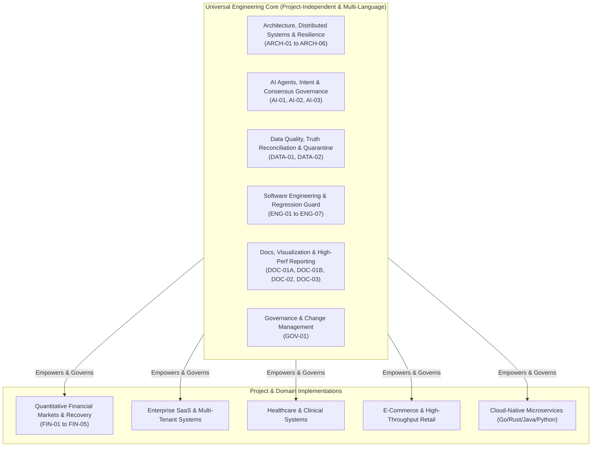

# Master AI Agent Skills System, Universal Engineering Taxonomy & Dynamic Router

Welcome to the **Master AI Agent Skills Registry, Universal Engineering Taxonomy & Dynamic Router**.

This registry organizes, governs, and indexes **27 specialized skills** (21 Universal Engineering & Governance Skills + 6 Isolated Domain-Specific Market Skills) into an enterprise-grade operating ecosystem. Any AI agent, subagent, or human engineer can dynamically adopt these persona instructions, execution pipelines, verification checklists, and domain knowledge bases.

---

## 🏛️ Foundational Architectural Philosophy

The universal skills library is governed by a strict architectural separation:

> **Universal Engineering Skills must remain completely project-independent, language-aware, and domain-agnostic.**  
> **Domain-Specific Skills (Financial/Trading/Market) inherit from and invoke Universal Skills, but Universal Skills must never depend on or hardcode domain concepts.**

---

## 🗂️ Master Skills Registry & Capability Matrix

| Code | Canonical Skill Name | File Link | Category | Applicable Stacks | Primary Responsibility & Operational Scope |
|:---:|---|---|:---:|---|---|
| **ARCH-01** | **Software Architecture & System Design** | [`architecture.md`](file:///E:/Stock%20Market/Stock_Market_Portfolio_Analysis/.skills/.Development_Skills/architecture.md) | Architecture | Universal, Multi-Language | High-level system design, modular monolith vs. microservices, trade-off scorecards, scalability, Strangler Fig migrations, and Architecture Decision Records (ADRs). |
| **ARCH-02** | **Microservices & Distributed Systems** | [`microservices.md`](file:///E:/Stock%20Market/Stock_Market_Portfolio_Analysis/.skills/.Development_Skills/microservices.md) | Architecture | Universal, Microservices | Bounded Contexts, SAGA pattern (Choreography/Orchestration), Transactional Outbox with Debezium CDC, CQRS read models, service mesh (Istio), and distributed tracing. |
| **ARCH-03** | **API Architecture & Integration Engineering** | [`integrations.md`](file:///E:/Stock%20Market/Stock_Market_Portfolio_Analysis/.skills/.Development_Skills/integrations.md) | Architecture | Universal, REST, Kafka, MQ | REST API discovery, endpoint catalogs, parameter schemas, pagination strategies (offset, page, cursor), multi-tier priority routing, failovers, and webhooks. |
| **ARCH-04** | **Database & Data Architecture** | [`database.md`](file:///E:/Stock%20Market/Stock_Market_Portfolio_Analysis/.skills/.Development_Skills/database.md) | Architecture | PostgreSQL, MySQL, Redis, Mongo | Relational schema design (3NF/BCNF), index optimization (composite, covering), execution plans (`EXPLAIN ANALYZE`), ACID isolation, Redis caching, and vector DBs. |
| **ARCH-05** | **Security Architecture & Defense Engineering** | [`security.md`](file:///E:/Stock%20Market/Stock_Market_Portfolio_Analysis/.skills/.Development_Skills/security.md) | Security | Universal, OAuth2, JWT | Token lifecycle (JWT/RS256), OAuth2/OIDC, RBAC/ABAC, API perimeter defense (rate limiting, CORS, CSP), OWASP Top 10 mitigation, and secret management (Vault/KMS). |
| **ARCH-06** | **Financial API Rate Limiting & Resilience** | [`financial-api-rate-limiting.md`](file:///E:/Stock%20Market/Stock_Market_Portfolio_Analysis/.skills/.Development_Skills/financial-api-rate-limiting.md) | Architecture | REST APIs, HTTP/2, Concurrency | Per-host token bucket rate limiting, polite delay request pacing, adaptive exponential backoff with full jitter on HTTP 429, three-layer envelope validation, and circuit breakers. |
| **AI-01** | **AI Agent Architecture & Multi-Agent Systems** | [`ai-agent-architecture.md`](file:///E:/Stock%20Market/Stock_Market_Portfolio_Analysis/.skills/.Development_Skills/ai-agent-architecture.md) | Artificial Intelligence | Universal, Python, TS, LangGraph | Multi-agent DAG workflows, agent capability registries, dynamic routing, state schemas, context isolation, specialist teams, and fault-tolerant local LLM fallbacks. |
| **AI-02** | **Dynamic Prompt & Intent Engineering** | [`prompt-engineering.md`](file:///E:/Stock%20Market/Stock_Market_Portfolio_Analysis/.skills/.Development_Skills/prompt-engineering.md) | Artificial Intelligence | Universal, Prompt Eng, LLMs | Natural language query decomposition, intent classification, constraint extraction, structured JSON schema prompting, and anti-hallucination discipline. |
| **AI-03** | **Multi-Agent Consensus & Explainability** | [`multi-agent-consensus-explainability.md`](file:///E:/Stock%20Market/Stock_Market_Portfolio_Analysis/.skills/.Development_Skills/multi-agent-consensus-explainability.md) | Artificial Intelligence | LangGraph, Agent Swarms | Bull vs. Bear adversarial debate arbitration, quantitative dissent matrices, multi-factor conviction scoring (Tech, Fund, News, Risk), immutable audit logging (`run_manifest.json`), and human-in-the-loop authorization gates. |
| **DATA-01** | **Data Quality, Provenance & Truth Reconciliation** | [`data-quality-reconciliation.md`](file:///E:/Stock%20Market/Stock_Market_Portfolio_Analysis/.skills/.Development_Skills/data-quality-reconciliation.md) | Data Engineering | Universal, SQL, Pandas, Polars | Truth Anchoring (canonical snapshots), cross-vendor reconciliation spread matrices, zero-synthetic fabrication enforcement, temporal integrity, and provenance audit logging. |
| **DATA-02** | **Multi-Market Isolation & Jurisdictional Quarantine** | [`market-isolation-quarantine.md`](file:///E:/Stock%20Market/Stock_Market_Portfolio_Analysis/.skills/.Development_Skills/market-isolation-quarantine.md) | Data Engineering | Universal, Python, Multi-Market | Strict geographical/jurisdictional isolation (US vs Indian equities), pre-dispatch provider gating, foreign record quarantine, currency symbol invariance (`$` vs `₹`), and count reconciliation. |
| **ENG-01** | **Software Engineering & Codebase Analysis** | [`project-analysis.md`](file:///E:/Stock%20Market/Stock_Market_Portfolio_Analysis/.skills/project-analysis.md) | Engineering | Universal, All Codebases | Codebase onboarding, portfolio tech stack discovery, architectural bottleneck audit, technical debt scoring, modular decomposition, and refactoring planning. |
| **ENG-02** | **Testing & Regression Engineering** | [`regression_skill.md`](file:///E:/Stock%20Market/Stock_Market_Portfolio_Analysis/.skills/.Regression_Skills/regression_skill.md) | Engineering | Universal (9 Major Stacks) | Universal multi-language test discovery (`pytest`, `mvn`, `npm`, `cargo`, `go test`), pre-change baseline testing, non-breaking safety ($\Delta_{\text{broken}}=0$), and CI/CD parity. |
| **ENG-03** | **Software Craftsmanship & Design Patterns** | [`design-patterns.md`](file:///E:/Stock%20Market/Stock_Market_Portfolio_Analysis/.skills/.Development_Skills/design-patterns.md) | Engineering | Java, Python, TS, Go, C# | Gang of Four (GoF) design patterns, SOLID principles, clean code craftsmanship, code smell elimination (God Object, Feature Envy), and circular dependency refactoring. |
| **ENG-04** | **Backend Engineering & Distributed Systems** | [`backend.md`](file:///E:/Stock%20Market/Stock_Market_Portfolio_Analysis/.skills/.Development_Skills/backend.md) | Engineering | Spring Boot, FastAPI, Node, Go | Layered service architecture (Controller, Service, Repository, DTO), non-blocking asynchronous processing, thread/connection pool tuning, and high-throughput microservices. |
| **ENG-05** | **Senior Frontend & Client Architecture** | [`frontend.md`](file:///E:/Stock%20Market/Stock_Market_Portfolio_Analysis/.skills/.Development_Skills/frontend.md) | Engineering | Angular, TypeScript, RxJS | Standalone components, reactive state management (RxJS, Signals), OnPush change detection, HTTP interceptors, accessible UI/UX, and component modularity. |
| **ENG-06** | **Lead QA & Test Automation Architecture** | [`testing.md`](file:///E:/Stock%20Market/Stock_Market_Portfolio_Analysis/.skills/.Development_Skills/testing.md) | Engineering | JUnit 5, Mockito, PyTest, Jest | Test Pyramid optimization, MockMvc, integration tests, contract testing (Pact), embedded test harnesses, mutation testing, and automated coverage gates. |
| **ENG-07** | **Cloud Architecture & DevOps Platform Engineering** | [`cloud-devops.md`](file:///E:/Stock%20Market/Stock_Market_Portfolio_Analysis/.skills/.Cloud_Skills/cloud-devops.md) | Engineering | Docker, Kubernetes, AWS, CI/CD | Multi-stage Docker builds, Kubernetes manifests, Helm charts, AWS infrastructure (EC2, S3, IAM), CI/CD pipeline automation, and production observability. |
| **DOC-01A** | **Documentation Synchronization & Gap Analysis** | [`documentation-sync-skill.md`](file:///E:/Stock%20Market/Stock_Market_Portfolio_Analysis/.skills/.Documentation_Skills/documentation-sync-skill.md) | Documentation | Universal, Markdown, Tech Docs | 14-phase documentation synchronization, codebase-to-doc gap analysis, documentation refactoring, API doc generation, and architecture specification curation. |
| **DOC-01B** | **Mermaid Architecture Visualization** | [`mermaid-diagram-skill.md`](file:///E:/Stock%20Market/Stock_Market_Portfolio_Analysis/.skills/.Documentation_Skills/mermaid-diagram-skill.md) | Documentation | Mermaid, Markdown, Visuals | Dual-theme (dark/light mode) Mermaid architectural diagram creation, sequence diagrams, ER diagrams, state machines, and visual syntax validation. |
| **DOC-02** | **Report Generation & Quality Engineering** | [`report-generation-quality-skill.md`](file:///E:/Stock%20Market/Stock_Market_Portfolio_Analysis/.skills/.Documentation_Skills/report-generation-quality-skill.md) | Documentation | HTML5, CSS3, Pure SVG, JS | Self-contained offline HTML dashboards, dark/light theme CSS variables, pure-SVG interactive charts, collapsible tables, verified source linkification, and print CSS. |
| **DOC-03** | **High-Performance HTML & Anti-Bloat Engineering** | [`report-performance-anti-bloat.md`](file:///E:/Stock%20Market/Stock_Market_Portfolio_Analysis/.skills/.Documentation_Skills/report-performance-anti-bloat.md) | Documentation | HTML5, CSS Containment, Web Perf | Strict document bundle budget ($\le 5\text{ MB}$ vs 48 MB bloat), table virtualization, CSS `content-visibility: auto`, modal details drawers, and zero-CDN packaging. |
| **GOV-01** | **Engineering Governance & Change Management** | [`engineering-practices.md`](file:///E:/Stock%20Market/Stock_Market_Portfolio_Analysis/.skills/.Development_Skills/engineering-practices.md) | Governance | Agile, Git, CI/CD, SonarQube | Agile Scrum ceremonies, Gherkin acceptance criteria (INVEST), Git branching (GitFlow, Trunk-Based), PR review standards, and SonarQube static analysis quality gates. |
| **FIN-01** | **Quantitative Technical Market Analysis** | [`stock-market-analyst-skill.md`](file:///E:/Stock%20Market/Stock_Market_Portfolio_Analysis/.skills/.Stock_Market_Skills/stock-market-analyst-skill.md) | Financial Markets | Financial Data, Equity, TA | Candlestick mathematics, EMA/RSI/VWAP technical confluence, pivot points, support/resistance, risk-reward modeling (1:2+), and relative volume (RVOL) analysis. |
| **FIN-02** | **Multi-Market Screener & Filtering Engine** | [`stock_market_skills.md`](file:///E:/Stock%20Market/Stock_Market_Portfolio_Analysis/.skills/.Stock_Market_Skills/stock_market_skills.md) | Financial Markets | Indian & U.S. Equities | Multi-asset screening prompt architectures for Indian (Screener.in/NSE) and U.S. (INDmoney/StockSifting/SEC) equity universes, filtering rules, and financial meta-skills. |
| **FIN-03** | **Teja Recovery Model (TRM) Quantitative Capital Recovery** | [`TRM_Algorithm_Skill.md`](file:///E:/Stock%20Market/Stock_Market_Portfolio_Analysis/.skills/.Stock_Market_Skills/TRM_%20Strategies/TRM_Algorithm_Skill.md) | Financial Markets | TRM Math (V1–V8), Portfolio | Proprietary TRM capital allocation and recovery mathematics (Original, V1–V8), recursive actual-loss dynamic scaling, dual-path price targets, dip averaging, and profit harvesting. |
| **FIN-04** | **Corporate Actions & Forward Catalysts Intelligence** | [`corporate-actions-catalysts.md`](file:///E:/Stock%20Market/Stock_Market_Portfolio_Analysis/.skills/.Stock_Market_Skills/corporate-actions-catalysts.md) | Financial Markets | Corporate Events, SSR Payloads | Ingestion and normalization of corporate calendars (dividends, splits, bonuses, rights, board meetings), stock split/bonus dilution adjustment factors, and catalyst freshness decay. |
| **FIN-05** | **Market Microstructure, Order Book Depth & Accumulation** | [`market-microstructure-depth.md`](file:///E:/Stock%20Market/Stock_Market_Portfolio_Analysis/.skills/.Stock_Market_Skills/market-microstructure-depth.md) | Financial Markets | Level-2 Depth, NSE, Microstructure | Level-2 5-bid/5-ask order book imbalance (OBI), true turnover-derived VWAP, institutional delivery accumulation percentage thresholds ($>50\%$), and pre-trade execution slippage. |

---

## 🧭 Dynamic Skill Invocation Protocol & Decision Trees

### 1. Task Routing Flowchart

```mermaid
flowchart TD
    TaskStart(["Incoming Task / Request"]) --> IntentCheck{"Analyze Intent & Domain"}

    %% Universal Engineering Paths
    IntentCheck -->|"Feature Development / Bug Fix / Refactor"| BranchDev{"Target Area?"}
    BranchDev -->|"System Architecture & Boundaries"| ARCH_CHOICE["ARCH-01 (architecture.md) or ARCH-02 (microservices.md)"]
    BranchDev -->|"REST / External API / Webhooks / Rate Limiting"| INT_CHOICE["ARCH-03 (integrations.md) + ARCH-06 (financial-api-rate-limiting.md)"]
    BranchDev -->|"Database / SQL / Indexing / Redis / Vector"| DB_CHOICE["ARCH-04 (database.md)"]
    BranchDev -->|"Security / Auth / Tokens / OWASP"| SEC_CHOICE["ARCH-05 (security.md)"]
    BranchDev -->|"AI Agents / Multi-Agent Graph / Routing"| AI_CHOICE["AI-01 (ai-agent-architecture.md)"]
    BranchDev -->|"Prompt Engineering / Intent Extraction"| PROMPT_CHOICE["AI-02 (prompt-engineering.md)"]
    BranchDev -->|"Multi-Agent Consensus / Dissent / Explainability"| CONSENSUS_CHOICE["AI-03 (multi-agent-consensus-explainability.md)"]
    BranchDev -->|"Data Quality / Truth Snapshot / Reconciliation"| DATA_CHOICE["DATA-01 (data-quality-reconciliation.md)"]
    BranchDev -->|"Cross-Market Isolation / Jurisdictional Quarantine"| QUAR_CHOICE["DATA-02 (market-isolation-quarantine.md)"]
    BranchDev -->|"Backend Services / Concurrency / Business Logic"| BE_CHOICE["ENG-04 (backend.md) + ENG-03 (design-patterns.md)"]
    BranchDev -->|"Frontend UI / Angular / Reactive State"| FE_CHOICE["ENG-05 (frontend.md)"]
    BranchDev -->|"Docker / Kubernetes / CI/CD Pipelines / Cloud"| CLOUD_CHOICE["ENG-07 (cloud-devops.md)"]

    %% Quality & Testing Mandate
    ARCH_CHOICE & INT_CHOICE & DB_CHOICE & SEC_CHOICE & AI_CHOICE & PROMPT_CHOICE & CONSENSUS_CHOICE & DATA_CHOICE & QUAR_CHOICE & BE_CHOICE & FE_CHOICE & CLOUD_CHOICE --> RegGuard["MANDATORY COMPANION:\nENG-02 (regression_skill.md)\nPre-baseline test, Δ_broken=0, CI parity"]

    %% Documentation & Reports
    IntentCheck -->|"Documentation / Diagrams / HTML Reports"| BranchDoc{"Documentation Type?"}
    BranchDoc -->|"Sync Docs / Gap Analysis / Tech Specs"| DOC_SYNC["DOC-01A (documentation-sync-skill.md)"]
    BranchDoc -->|"Mermaid Diagrams / Visual Architecture"| DOC_MERMAID["DOC-01B (mermaid-diagram-skill.md)"]
    BranchDoc -->|"Executive / Analytical Offline HTML Report"| DOC_REPORT["DOC-02 (report-generation-quality-skill.md) + DOC-03 (report-performance-anti-bloat.md)"]

    %% Codebase Audit & Governance
    IntentCheck -->|"Audit Codebase / Tech Debt / Architecture Review"| ENG_AUDIT["ENG-01 (project-analysis.md) + GOV-01 (engineering-practices.md)"]

    %% Domain-Specific Financial Trading
    IntentCheck -->|"Stock Market / Screener / TRM Trading"| BranchFin{"Financial Scope?"}
    BranchFin -->|"Technical Analysis / Candlesticks / Indicators"| FIN_TA["FIN-01 (stock-market-analyst-skill.md)"]
    BranchFin -->|"Indian (Screener/NSE) / U.S. (INDmoney/SEC) Screeners"| FIN_SCREEN["FIN-02 (stock_market_skills.md)"]
    BranchFin -->|"TRM Capital Recovery / Dip Averaging / V1-V8"| FIN_TRM["FIN-03 (TRM_Algorithm_Skill.md)"]
    BranchFin -->|"Corporate Actions / Dividends / Stock Splits / Calendars"| FIN_CORP["FIN-04 (corporate-actions-catalysts.md)"]
    BranchFin -->|"Order Book Depth / True VWAP / Delivery Accumulation"| FIN_MICRO["FIN-05 (market-microstructure-depth.md)"]

    FIN_TA & FIN_SCREEN & FIN_TRM & FIN_CORP & FIN_MICRO --> FIN_GOV["Governed by DATA-01 (Truth Anchoring),\nDATA-02 (Market Isolation) and DOC-03 (Anti-Bloat Reports)"]
```

---

### 2. Multi-Skill Composition Recipes for Advanced Scenarios

| Workflow Archetype | Primary Skill | Companion Skills | Execution Sequence |
|---|---|---|---|
| **Multi-Market API Integration & Isolation** | `DATA-02` (Market Isolation) | `ARCH-03` (Integrations), `ARCH-06` (Rate Limiting), `ENG-02` (Regression) | 1. `ARCH-03` & `ARCH-06`: Register APIs with per-host token bucket and market tags. 2. `DATA-02`: Enforce pre-dispatch provider filtering and quarantine foreign feeds. 3. `DATA-01`: Verify zero synthetic data and reconcile cross-vendor quotes. 4. `ENG-02`: Run dual-market regression test suite ensuring zero leak. |
| **High-Performance Executive Dashboard** | `DOC-02` (Report Generation) | `DOC-03` (Anti-Bloat), `DATA-01` (Truth Snapshot), `DOC-01B` (Mermaid) | 1. `DATA-01`: Prepare reconciled canonical snapshot. 2. `DOC-03`: Enforce $\le 5\text{ MB}$ budget, apply `content-visibility: auto`, cap tables. 3. `DOC-01B`: Render dark/light responsive Mermaid architecture diagrams. 4. `DOC-02`: Generate portable offline HTML with pure-SVG interactive charts. |
| **Multi-Agent Debate & Explainable Trading** | `AI-03` (Consensus & Explainability) | `AI-01` (Agent Graph), `FIN-01` (Technicals), `FIN-04` (Catalysts), `GOV-01` (Governance) | 1. `AI-01`: Execute specialist swarm in synchronized DAG. 2. `AI-03`: Arbitrate Bull vs. Bear debate, formulate quantitative dissent matrix. 3. `FIN-04`: Weight forward catalysts and price dilution adjustments. 4. `AI-03` & `GOV-01`: Log immutable reasoning trace in `run_manifest.json` and gate trade execution. |
| **Institutional Microstructure & Recovery Execution** | `FIN-03` (TRM Algorithm) | `FIN-05` (Microstructure), `FIN-01` (Technicals), `ARCH-06` (Rate Limiting) | 1. `ARCH-06`: Stream high-frequency quotes with token bucket rate limiting. 2. `FIN-05`: Derive true turnover VWAP, order book imbalance, and delivery %. 3. `FIN-03`: Execute TRM V1–V8 recovery math, calculating dynamic dip allocations. 4. `FIN-05`: Model execution slippage and set hard invalidation stop-loss. |

---

## 🛡️ Core Capability Highlights

### 1. `DATA-02`: Multi-Market Isolation & Jurisdictional Quarantine (`market-isolation-quarantine.md`)
- **Pre-Dispatch Elimination**: Incompatible providers (e.g. Groww/NSE for US, or NASDAQ for India) are eliminated before network calls.
- **Strict Consolidation Quarantine**: Foreign corporate actions, feeds, and exchange announcements are dropped into an isolation audit log.
- **Currency & Identity Consistency**: Enforces dynamic resolution via `is_us_instrument` vs `is_indian_instrument`, guaranteeing `$` for US and `₹` for India without symbol collisions (`USD (₹)`).
- **Count Accounting Reconciliation**: Verifies that acquired, accepted, excluded, and displayed item counts reconcile mathematically.

### 2. `ARCH-06`: Financial API Rate Limiting & Vendor Resilience (`financial-api-rate-limiting.md`)
- **Host-Scoped Token Bucket**: Enforces strict requests-per-second limits across external financial endpoints.
- **Polite Request Pacing**: Guarantees non-burst inter-request delays (0.5s–1.0s) to prevent server throttling.
- **Adaptive Full-Jitter Backoff**: Handles HTTP 429 and network disconnects using randomized exponential backoff.
- **Three-Layer Validation**: Validates transport HTTP status, business envelope `rCode`, and payload completeness without fabricating fake data.

### 3. `DOC-03`: High-Performance HTML & Anti-Bloat Engineering (`report-performance-anti-bloat.md`)
- **5 MB Document Budget**: Strictly enforces report bundle sizes under 5.0 MB (typically 2.0–3.0 MB vs 48 MB bloat).
- **CSS Performance Containment**: Leverages `content-visibility: auto` and `contain-intrinsic-size` to optimize rendering of thousands of table rows.
- **Modal Details Architecture**: Houses verbose coverage texts in client-side modal dialogs and `
` drawers to prevent DOM explosion.
- **100% Offline Portability**: Zero CDN dependencies; KaTeX math, pure SVGs, and theme variables run completely offline.

### 4. `AI-03`: Multi-Agent Consensus & Explainability Governance (`multi-agent-consensus-explainability.md`)
- **Adversarial Debate Arbitration**: Balances Bullish and Bearish specialist theses with cited evidence.
- **Dissent Matrix**: Quantifies conviction spread between competing agents to downsize allocations during high conflict.
- **Four-Pillar Conviction Weights**: Integrates Technical (30%), Fundamental (25%), News/Catalysts (20%), and Risk Penalty factors.
- **Immutable Run Manifest**: Records complete tool executions, telemetry, and evidence IDs in `run_manifest.json`.

---

## 🏆 The Five Tenets of Production-Grade AI Skills

Every skill in this registry strictly enforces:
1. **Explicit Operational Boundaries**: Clear triggers, negative constraints, and anti-patterns.
2. **Deterministic Multi-Phase Pipelines**: Step-by-step engineering workflows with explicit phase gates.
3. **Multi-Stack Genericism**: Universally applicable across modern programming languages and platforms.
4. **Proactive Failure Mitigation**: Concrete fallback strategies for timeouts, vendor outages, rate limits, and edge cases.
5. **Deterministic Verification Checklists**: Measurable pass/fail criteria required before marking any task complete.

---
*Maintained by: Enterprise AI Agent Architecture & Universal Skills Registry*  
*Last Updated: November 10, 2026*
