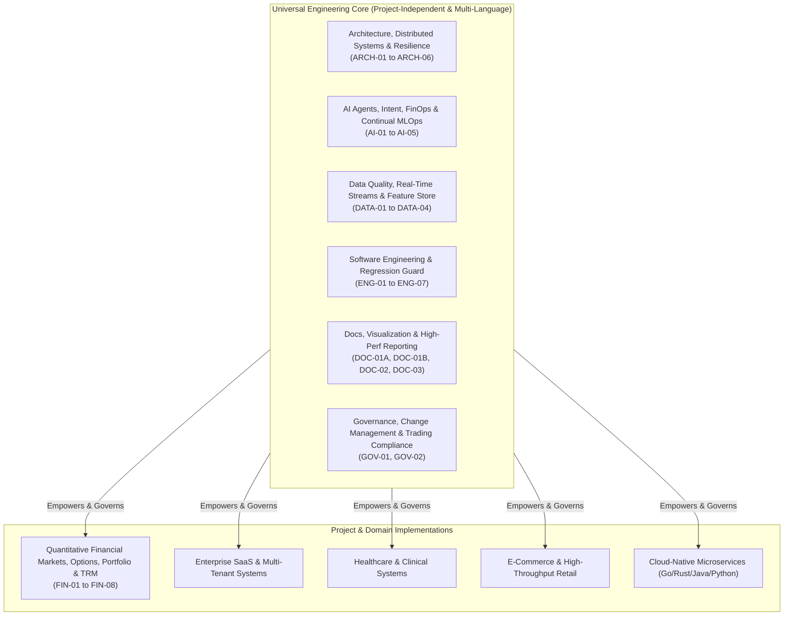

# Master AI Agent Skills System, Universal Engineering Taxonomy & Dynamic Router

Welcome to the **Master AI Agent Skills Registry, Universal Engineering Taxonomy & Dynamic Router**.

This registry organizes, governs, and indexes **36 specialized skills** (28 Universal Engineering, Infrastructure & Governance Skills + 8 Isolated Domain-Specific Quantitative Market Skills) into an enterprise-grade operating ecosystem. Any AI agent, subagent, or human engineer can dynamically adopt these persona instructions, execution pipelines, verification checklists, and domain knowledge bases.

---

## 🏛️ Foundational Architectural Philosophy

The universal skills library is governed by a strict architectural separation:

> **Universal Engineering Skills must remain completely project-independent, language-aware, and domain-agnostic.**  
> **Domain-Specific Skills (Financial/Trading/Market) inherit from and invoke Universal Skills, but Universal Skills must never depend on or hardcode domain concepts.**

---

## 🗂️ Master Skills Registry & Capability Matrix

| Code | Canonical Skill Name | File Link | Category | Applicable Stacks | Primary Responsibility & Operational Scope |
|:---:|---|---|:---:|---|---|
| **ARCH-01** | **Software Architecture & System Design** | [`architecture.md`](file:///E:/Stock%20Market/Stock_Market_Portfolio_Analysis/.skills/.Development_Skills/architecture.md) | Architecture | Universal, Multi-Language | High-level system design, modular monolith vs. microservices, trade-off scorecards, scalability, Strangler Fig migrations, and Architecture Decision Records (ADRs). |
| **ARCH-02** | **Microservices & Distributed Systems** | [`microservices.md`](file:///E:/Stock%20Market/Stock_Market_Portfolio_Analysis/.skills/.Development_Skills/microservices.md) | Architecture | Universal, Microservices | Bounded Contexts, SAGA pattern (Choreography/Orchestration), Transactional Outbox with Debezium CDC, CQRS read models, service mesh (Istio), and distributed tracing. |
| **ARCH-03** | **API Architecture & Integration Engineering** | [`integrations.md`](file:///E:/Stock%20Market/Stock_Market_Portfolio_Analysis/.skills/.Development_Skills/integrations.md) | Architecture | Universal, REST, Kafka, MQ | REST API discovery, endpoint catalogs, parameter schemas, pagination strategies (offset, page, cursor), multi-tier priority routing, failovers, and webhooks. |
| **ARCH-04** | **Database & Data Architecture** | [`database.md`](file:///E:/Stock%20Market/Stock_Market_Portfolio_Analysis/.skills/.Development_Skills/database.md) | Architecture | PostgreSQL, MySQL, Redis, Mongo | Relational schema design (3NF/BCNF), index optimization (composite, covering), execution plans (`EXPLAIN ANALYZE`), ACID isolation, Redis caching, and vector DBs. |
| **ARCH-05** | **Security Architecture & Defense Engineering** | [`security.md`](file:///E:/Stock%20Market/Stock_Market_Portfolio_Analysis/.skills/.Development_Skills/security.md) | Security | Universal, OAuth2, JWT | Token lifecycle (JWT/RS256), OAuth2/OIDC, RBAC/ABAC, API perimeter defense (rate limiting, CORS, CSP), OWASP Top 10 mitigation, and secret management (Vault/KMS). |
| **ARCH-06** | **Financial API Rate Limiting & Resilience** | [`financial-api-rate-limiting.md`](file:///E:/Stock%20Market/Stock_Market_Portfolio_Analysis/.skills/.Development_Skills/financial-api-rate-limiting.md) | Architecture | REST APIs, HTTP/2, Concurrency | Per-host token bucket rate limiting, polite delay request pacing, adaptive exponential backoff with full jitter on HTTP 429, three-layer envelope validation, and circuit breakers. |
| **AI-01** | **AI Agent Architecture & Multi-Agent Systems** | [`ai-agent-architecture.md`](file:///E:/Stock%20Market/Stock_Market_Portfolio_Analysis/.skills/.Development_Skills/ai-agent-architecture.md) | Artificial Intelligence | Universal, Python, TS, LangGraph | Multi-agent DAG workflows, agent capability registries, dynamic routing, state schemas, context isolation, specialist teams, and fault-tolerant local LLM fallbacks. |
| **AI-02** | **Dynamic Prompt & Intent Engineering** | [`prompt-engineering.md`](file:///E:/Stock%20Market/Stock_Market_Portfolio_Analysis/.skills/.Development_Skills/prompt-engineering.md) | Artificial Intelligence | Universal, Prompt Eng, LLMs | Natural language query decomposition, intent classification, constraint extraction, structured JSON schema prompting, and anti-hallucination discipline. |
| **AI-03** | **Multi-Agent Consensus & Explainability** | [`multi-agent-consensus-explainability.md`](file:///E:/Stock%20Market/Stock_Market_Portfolio_Analysis/.skills/.Development_Skills/multi-agent-consensus-explainability.md) | Artificial Intelligence | LangGraph, Agent Swarms | Bull vs. Bear adversarial debate arbitration, quantitative dissent matrices, multi-factor conviction scoring (Tech, Fund, News, Risk), immutable audit logging (`run_manifest.json`), and human-in-the-loop authorization gates. |
| **AI-04** | **LLM Cost, Token Economics & Latency Optimization** | [`llm-cost-token-latency-optimization.md`](file:///E:/Stock%20Market/Stock_Market_Portfolio_Analysis/.skills/.Development_Skills/llm-cost-token-latency-optimization.md) | Artificial Intelligence | LangChain, LangGraph, vLLM, Ollama | Two-tier model routing (`quick_think` vs `deep_think`), semantic prompt caching, financial payload minification, token budget caps per node, and streaming latency governance. |
| **AI-05** | **Quantitative MLOps & Strategy Drift Monitoring** | [`mlops-strategy-drift-monitoring.md`](file:///E:/Stock%20Market/Stock_Market_Portfolio_Analysis/.skills/.Development_Skills/mlops-strategy-drift-monitoring.md) | Artificial Intelligence | MLflow, Evidently AI, PyTorch, SciPy | Information Coefficient (IC) tracking, alpha decay detection, Population Stability Index (PSI), two-sample Kolmogorov-Smirnov drift tests, agent Brier calibration, and champion-challenger shadow evaluation. |
| **DATA-01** | **Data Quality, Provenance & Truth Reconciliation** | [`data-quality-reconciliation.md`](file:///E:/Stock%20Market/Stock_Market_Portfolio_Analysis/.skills/.Development_Skills/data-quality-reconciliation.md) | Data Engineering | Universal, SQL, Pandas, Polars | Truth Anchoring (canonical snapshots), cross-vendor reconciliation spread matrices, zero-synthetic fabrication enforcement, temporal integrity, and provenance audit logging. |
| **DATA-02** | **Multi-Market Isolation & Jurisdictional Quarantine** | [`market-isolation-quarantine.md`](file:///E:/Stock%20Market/Stock_Market_Portfolio_Analysis/.skills/.Development_Skills/market-isolation-quarantine.md) | Data Engineering | Universal, Python, Multi-Market | Strict geographical/jurisdictional isolation (US vs Indian equities), pre-dispatch provider gating, foreign record quarantine, currency symbol invariance (`$` vs `₹`), and count reconciliation. |
| **DATA-03** | **Real-Time Market Streaming & WebSockets** | [`realtime-streaming-websockets.md`](file:///E:/Stock%20Market/Stock_Market_Portfolio_Analysis/.skills/.Development_Skills/realtime-streaming-websockets.md) | Data Engineering | asyncio, websockets, Netty, Spring WS | Bidirectional WebSocket lifecycle, tick-by-tick order book stream ingestion, sliding-window OHLCV candle aggregator (1s, 5s, 1m), Disruptor lock-free ring buffering, backpressure handling, and automatic reconnect replay. |
| **DATA-04** | **Quantitative Feature Store & Data Lake** | [`feature-store-datalake.md`](file:///E:/Stock%20Market/Stock_Market_Portfolio_Analysis/.skills/.Development_Skills/feature-store-datalake.md) | Data Engineering | Parquet, DuckDB, Polars, Arrow, ClickHouse | High-performance columnar data lake, strict point-in-time (PIT) join semantics eliminating financial look-ahead bias, momentum/volatility factor engineering, and dual online-offline store synchronization. |
| **ENG-01** | **Software Engineering & Codebase Analysis** | [`project-analysis.md`](file:///E:/Stock%20Market/Stock_Market_Portfolio_Analysis/.skills/project-analysis.md) | Engineering | Universal, All Codebases | Codebase onboarding, portfolio tech stack discovery, architectural bottleneck audit, technical debt scoring, modular decomposition, and refactoring planning. |
| **ENG-02** | **Testing & Regression Engineering** | [`regression_skill.md`](file:///E:/Stock%20Market/Stock_Market_Portfolio_Analysis/.skills/.Regression_Skills/regression_skill.md) | Engineering | Universal (9 Major Stacks) | Universal multi-language test discovery (`pytest`, `mvn`, `npm`, `cargo`, `go test`), pre-change baseline testing, non-breaking safety ($\Delta_{\text{broken}}=0$), and CI/CD parity. |
| **ENG-03** | **Software Craftsmanship & Design Patterns** | [`design-patterns.md`](file:///E:/Stock%20Market/Stock_Market_Portfolio_Analysis/.skills/.Development_Skills/design-patterns.md) | Engineering | Java, Python, TS, Go, C# | Gang of Four (GoF) design patterns, SOLID principles, clean code craftsmanship, code smell elimination (God Object, Feature Envy), and circular dependency refactoring. |
| **ENG-04** | **Backend Engineering & Distributed Systems** | [`backend.md`](file:///E:/Stock%20Market/Stock_Market_Portfolio_Analysis/.skills/.Development_Skills/backend.md) | Engineering | Spring Boot, FastAPI, Node, Go | Layered service architecture (Controller, Service, Repository, DTO), non-blocking asynchronous processing, thread/connection pool tuning, and high-throughput microservices. |
| **ENG-05** | **Senior Frontend & Client Architecture** | [`frontend.md`](file:///E:/Stock%20Market/Stock_Market_Portfolio_Analysis/.skills/.Development_Skills/frontend.md) | Engineering | Angular, TypeScript, RxJS | Standalone components, reactive state management (RxJS, Signals), OnPush change detection, HTTP interceptors, accessible UI/UX, and component modularity. |
| **ENG-06** | **Lead QA & Test Automation Architecture** | [`testing.md`](file:///E:/Stock%20Market/Stock_Market_Portfolio_Analysis/.skills/.Development_Skills/testing.md) | Engineering | JUnit 5, Mockito, PyTest, Jest | Test Pyramid optimization, MockMvc, integration tests, contract testing (Pact), embedded test harnesses, mutation testing, and automated coverage gates. |
| **ENG-07** | **Cloud Architecture & DevOps Platform Engineering** | [`cloud-devops.md`](file:///E:/Stock%20Market/Stock_Market_Portfolio_Analysis/.skills/.Cloud_Skills/cloud-devops.md) | Engineering | Docker, Kubernetes, AWS, CI/CD | Multi-stage Docker builds, Kubernetes manifests, Helm charts, AWS infrastructure (EC2, S3, IAM), CI/CD pipeline automation, and production observability. |
| **DOC-01A** | **Documentation Synchronization & Gap Analysis** | [`documentation-sync-skill.md`](file:///E:/Stock%20Market/Stock_Market_Portfolio_Analysis/.skills/.Documentation_Skills/documentation-sync-skill.md) | Documentation | Universal, Markdown, Tech Docs | 14-phase documentation synchronization, codebase-to-doc gap analysis, documentation refactoring, API doc generation, and architecture specification curation. |
| **DOC-01B** | **Mermaid Architecture Visualization** | [`mermaid-diagram-skill.md`](file:///E:/Stock%20Market/Stock_Market_Portfolio_Analysis/.skills/.Documentation_Skills/mermaid-diagram-skill.md) | Documentation | Mermaid, Markdown, Visuals | Dual-theme (dark/light mode) Mermaid architectural diagram creation, sequence diagrams, ER diagrams, state machines, and visual syntax validation. |
| **DOC-02** | **Report Generation & Quality Engineering** | [`report-generation-quality-skill.md`](file:///E:/Stock%20Market/Stock_Market_Portfolio_Analysis/.skills/.Documentation_Skills/report-generation-quality-skill.md) | Documentation | HTML5, CSS3, Pure SVG, JS | Self-contained offline HTML dashboards, dark/light theme CSS variables, pure-SVG interactive charts, collapsible tables, verified source linkification, and print CSS. |
| **DOC-03** | **High-Performance HTML & Anti-Bloat Engineering** | [`report-performance-anti-bloat.md`](file:///E:/Stock%20Market/Stock_Market_Portfolio_Analysis/.skills/.Documentation_Skills/report-performance-anti-bloat.md) | Documentation | HTML5, CSS Containment, Web Perf | Strict document bundle budget ($\le 5\text{ MB}$ vs 48 MB bloat), table virtualization, CSS `content-visibility: auto`, modal details drawers, and zero-CDN packaging. |
| **GOV-01** | **Engineering Governance & Change Management** | [`engineering-practices.md`](file:///E:/Stock%20Market/Stock_Market_Portfolio_Analysis/.skills/.Development_Skills/engineering-practices.md) | Governance | Agile, Git, CI/CD, SonarQube | Agile Scrum ceremonies, Gherkin acceptance criteria (INVEST), Git branching (GitFlow, Trunk-Based), PR review standards, and SonarQube static analysis quality gates. |
| **GOV-02** | **Trading Regulatory Compliance & Risk Kill-Switches** | [`trading-compliance-risk-guardrails.md`](file:///E:/Stock%20Market/Stock_Market_Portfolio_Analysis/.skills/.Development_Skills/trading-compliance-risk-guardrails.md) | Governance | SEBI, SEC, FINRA, FIX Protocol | Statutory compliance (Upper/Lower Circuit filters, SEBI ASM/GSM lists, SEC Rule 15c3-5, PDT rules), 5 pre-trade risk gates, intraday drawdown kill-switch, and emergency flattening panic API. |
| **FIN-01** | **Quantitative Technical Market Analysis** | [`stock-market-analyst-skill.md`](file:///E:/Stock%20Market/Stock_Market_Portfolio_Analysis/.skills/.Stock_Market_Skills/stock-market-analyst-skill.md) | Financial Markets | Financial Data, Equity, TA | Candlestick mathematics, EMA/RSI/VWAP technical confluence, pivot points, support/resistance, risk-reward modeling (1:2+), and relative volume (RVOL) analysis. |
| **FIN-02** | **Multi-Market Screener & Filtering Engine** | [`stock_market_skills.md`](file:///E:/Stock%20Market/Stock_Market_Portfolio_Analysis/.skills/.Stock_Market_Skills/stock_market_skills.md) | Financial Markets | Indian & U.S. Equities | Multi-asset screening prompt architectures for Indian (Screener.in/NSE) and U.S. (INDmoney/StockSifting/SEC) equity universes, filtering rules, and financial meta-skills. |
| **FIN-03** | **Teja Recovery Model (TRM) Quantitative Capital Recovery** | [`TRM_Algorithm_Skill.md`](file:///E:/Stock%20Market/Stock_Market_Portfolio_Analysis/.skills/.Stock_Market_Skills/TRM_%20Strategies/TRM_Algorithm_Skill.md) | Financial Markets | TRM Math (V1–V8), Portfolio | Proprietary TRM capital allocation and recovery mathematics (Original, V1–V8), recursive actual-loss dynamic scaling, dual-path price targets, dip averaging, and profit harvesting. |
| **FIN-04** | **Corporate Actions & Forward Catalysts Intelligence** | [`corporate-actions-catalysts.md`](file:///E:/Stock%20Market/Stock_Market_Portfolio_Analysis/.skills/.Stock_Market_Skills/corporate-actions-catalysts.md) | Financial Markets | Corporate Events, SSR Payloads | Ingestion and normalization of corporate calendars (dividends, splits, bonuses, rights, board meetings), stock split/bonus dilution adjustment factors, and catalyst freshness decay. |
| **FIN-05** | **Market Microstructure, Order Book Depth & Accumulation** | [`market-microstructure-depth.md`](file:///E:/Stock%20Market/Stock_Market_Portfolio_Analysis/.skills/.Stock_Market_Skills/market-microstructure-depth.md) | Financial Markets | Level-2 Depth, NSE, Microstructure | Level-2 5-bid/5-ask order book imbalance (OBI), true turnover-derived VWAP, institutional delivery accumulation percentage thresholds ($>50\%$), and pre-trade execution slippage. |
| **FIN-06** | **Quantitative Derivatives, Options & Volatility Surfaces** | [`derivatives-options-greeks.md`](file:///E:/Stock%20Market/Stock_Market_Portfolio_Analysis/.skills/.Stock_Market_Skills/derivatives-options-greeks.md) | Financial Markets | Options Chains, QuantLib, Greeks | Black-Scholes-Merton and Bjerksund-Stensland pricing, first/second-order Greeks ($\Delta, \Gamma, \Theta, \mathcal{V}, \rho$), Put-Call Ratio (PCR), Max Pain strike minimization, OI buildup/unwinding, and 25-delta volatility skew. |
| **FIN-07** | **Quantitative Backtesting & Monte Carlo Simulation** | [`quantitative-backtesting-simulation.md`](file:///E:/Stock%20Market/Stock_Market_Portfolio_Analysis/.skills/.Stock_Market_Skills/quantitative-backtesting-simulation.md) | Financial Markets | VectorBT, Backtrader, PyTest | Bias-free historical simulation, Purged & Embargoed Cross-Validation, quadratic market impact slippage, statutory fee drag, Deflated Sharpe Ratio (DSR), and 10,000-path Monte Carlo equity resampling. |
| **FIN-08** | **Portfolio Rebalancing & Tax-Loss Optimization** | [`portfolio-rebalancing-tax-optimization.md`](file:///E:/Stock%20Market/Stock_Market_Portfolio_Analysis/.skills/.Stock_Market_Skills/portfolio-rebalancing-tax-optimization.md) | Financial Markets | MVO, Risk Parity, Taxes | Ledoit-Wolf shrinkage Mean-Variance Optimization, Hierarchical Risk Parity (HRP), tolerance band drift rebalancing, and tax-loss harvesting under Indian (STCG 20%, LTCG 12.5%) and US (30-day Wash-Sale rule) tax codes. |

---

## 🧭 Dynamic Skill Invocation Protocol & Decision Trees

### 1. Master Task Routing Flowchart

```mermaid
flowchart TD
    TaskStart(["Incoming Task / Request"]) --> IntentCheck{"Analyze Intent & Domain"}

    %% Universal Engineering Paths
    IntentCheck -->|"Feature Development / Bug Fix / Refactor"| BranchDev{"Target Area?"}
    BranchDev -->|"System Architecture & Boundaries"| ARCH_CHOICE["ARCH-01 (architecture.md) or ARCH-02 (microservices.md)"]
    BranchDev -->|"REST / External API / Webhooks / Rate Limiting"| INT_CHOICE["ARCH-03 (integrations.md) + ARCH-06 (financial-api-rate-limiting.md)"]
    BranchDev -->|"Real-Time Streaming / WebSockets / Ticks"| STREAM_CHOICE["DATA-03 (realtime-streaming-websockets.md)"]
    BranchDev -->|"Database / SQL / Indexing / Redis / Vector"| DB_CHOICE["ARCH-04 (database.md)"]
    BranchDev -->|"Feature Store / Parquet / Columnar Lake"| FS_CHOICE["DATA-04 (feature-store-datalake.md)"]
    BranchDev -->|"Security / Auth / Tokens / OWASP"| SEC_CHOICE["ARCH-05 (security.md)"]
    BranchDev -->|"AI Agents / Multi-Agent Graph / Routing"| AI_CHOICE["AI-01 (ai-agent-architecture.md)"]
    BranchDev -->|"Prompt Engineering / Intent Extraction"| PROMPT_CHOICE["AI-02 (prompt-engineering.md)"]
    BranchDev -->|"Multi-Agent Consensus / Dissent / Explainability"| CONSENSUS_CHOICE["AI-03 (multi-agent-consensus-explainability.md)"]
    BranchDev -->|"LLM Cost / Token Budget / Latency / Caching"| FINOPS_CHOICE["AI-04 (llm-cost-token-latency-optimization.md)"]
    BranchDev -->|"MLOps / Alpha Decay / Concept Drift"| MLOPS_CHOICE["AI-05 (mlops-strategy-drift-monitoring.md)"]
    BranchDev -->|"Data Quality / Truth Snapshot / Reconciliation"| DATA_CHOICE["DATA-01 (data-quality-reconciliation.md)"]
    BranchDev -->|"Cross-Market Isolation / Jurisdictional Quarantine"| QUAR_CHOICE["DATA-02 (market-isolation-quarantine.md)"]
    BranchDev -->|"Backend Services / Concurrency / Business Logic"| BE_CHOICE["ENG-04 (backend.md) + ENG-03 (design-patterns.md)"]
    BranchDev -->|"Frontend UI / Angular / Reactive State"| FE_CHOICE["ENG-05 (frontend.md)"]
    BranchDev -->|"Docker / Kubernetes / CI/CD Pipelines / Cloud"| CLOUD_CHOICE["ENG-07 (cloud-devops.md)"]

    %% Quality & Testing Mandate
    ARCH_CHOICE & INT_CHOICE & STREAM_CHOICE & DB_CHOICE & FS_CHOICE & SEC_CHOICE & AI_CHOICE & PROMPT_CHOICE & CONSENSUS_CHOICE & FINOPS_CHOICE & MLOPS_CHOICE & DATA_CHOICE & QUAR_CHOICE & BE_CHOICE & FE_CHOICE & CLOUD_CHOICE --> RegGuard["MANDATORY COMPANION:\nENG-02 (regression_skill.md)\nPre-baseline test, Δ_broken=0, CI parity"]

    %% Documentation & Reports
    IntentCheck -->|"Documentation / Diagrams / HTML Reports"| BranchDoc{"Documentation Type?"}
    BranchDoc -->|"Sync Docs / Gap Analysis / Tech Specs"| DOC_SYNC["DOC-01A (documentation-sync-skill.md)"]
    BranchDoc -->|"Mermaid Diagrams / Visual Architecture"| DOC_MERMAID["DOC-01B (mermaid-diagram-skill.md)"]
    BranchDoc -->|"Executive / Analytical Offline HTML Report"| DOC_REPORT["DOC-02 (report-generation-quality-skill.md) + DOC-03 (report-performance-anti-bloat.md)"]

    %% Codebase Audit & Governance
    IntentCheck -->|"Audit Codebase / Tech Debt / Governance / Compliance"| BranchGov{"Governance Area?"}
    BranchGov -->|"Codebase Tech Debt & Process"| ENG_AUDIT["ENG-01 (project-analysis.md) + GOV-01 (engineering-practices.md)"]
    BranchGov -->|"Trading Compliance & Risk Kill-Switches"| COMPL_AUDIT["GOV-02 (trading-compliance-risk-guardrails.md)"]

    %% Domain-Specific Financial Trading
    IntentCheck -->|"Stock Market / Screener / TRM / Derivatives / Quant"| BranchFin{"Financial Scope?"}
    BranchFin -->|"Technical Analysis / Candlesticks / Indicators"| FIN_TA["FIN-01 (stock-market-analyst-skill.md)"]
    BranchFin -->|"Indian (Screener/NSE) / U.S. (INDmoney/SEC) Screeners"| FIN_SCREEN["FIN-02 (stock_market_skills.md)"]
    BranchFin -->|"TRM Capital Recovery / Dip Averaging / V1-V8"| FIN_TRM["FIN-03 (TRM_Algorithm_Skill.md)"]
    BranchFin -->|"Corporate Actions / Dividends / Stock Splits / Calendars"| FIN_CORP["FIN-04 (corporate-actions-catalysts.md)"]
    BranchFin -->|"Order Book Depth / True VWAP / Delivery Accumulation"| FIN_MICRO["FIN-05 (market-microstructure-depth.md)"]
    BranchFin -->|"Options Chain / Greeks / PCR / Max Pain / Volatility"| FIN_OPT["FIN-06 (derivatives-options-greeks.md)"]
    BranchFin -->|"Strategy Backtesting / Walk-Forward / Monte Carlo"| FIN_BACKTEST["FIN-07 (quantitative-backtesting-simulation.md)"]
    BranchFin -->|"Portfolio Optimization / Rebalancing / Tax-Loss Harvesting"| FIN_PORT["FIN-08 (portfolio-rebalancing-tax-optimization.md)"]

    FIN_TA & FIN_SCREEN & FIN_TRM & FIN_CORP & FIN_MICRO & FIN_OPT & FIN_BACKTEST & FIN_PORT --> FIN_GOV["Governed by DATA-01 (Truth Anchoring),\nDATA-02 (Market Isolation), GOV-02 (Compliance Guardrails),\nand DOC-03 (Anti-Bloat Reports)"]
```

---

### 2. Multi-Skill Composition Recipes for Enterprise Scenarios

| Workflow Archetype | Primary Skill | Companion Skills | Execution Sequence |
|---|---|---|---|
| **Multi-Market API Integration & Isolation** | `DATA-02` (Market Isolation) | `ARCH-03` (Integrations), `ARCH-06` (Rate Limiting), `ENG-02` (Regression) | 1. `ARCH-03` & `ARCH-06`: Register APIs with per-host token bucket and market tags. 2. `DATA-02`: Enforce pre-dispatch provider filtering and quarantine foreign feeds. 3. `DATA-01`: Verify zero synthetic data and reconcile cross-vendor quotes. 4. `ENG-02`: Run dual-market regression test suite ensuring zero leak. |
| **High-Performance Executive Dashboard** | `DOC-02` (Report Generation) | `DOC-03` (Anti-Bloat), `DATA-01` (Truth Snapshot), `DOC-01B` (Mermaid) | 1. `DATA-01`: Prepare reconciled canonical snapshot. 2. `DOC-03`: Enforce $\le 5\text{ MB}$ budget, apply `content-visibility: auto`, cap tables. 3. `DOC-01B`: Render dark/light responsive Mermaid architecture diagrams. 4. `DOC-02`: Generate portable offline HTML with pure-SVG interactive charts. |
| **Multi-Agent Debate & Explainable Trading** | `AI-03` (Consensus & Explainability) | `AI-01` (Agent Graph), `AI-04` (Token FinOps), `FIN-01` (Technicals), `GOV-02` (Compliance) | 1. `AI-04`: Apply semantic prompt caching and minify financial payloads. 2. `AI-01`: Execute specialist swarm in synchronized DAG within token budget. 3. `AI-03`: Arbitrate Bull vs. Bear debate, formulate quantitative dissent matrix. 4. `GOV-02`: Verify 5 pre-trade compliance gates and log immutable execution manifest. |
| **Institutional Derivatives & Expiry Trading** | `FIN-06` (Derivatives & Greeks) | `FIN-05` (Microstructure), `DATA-03` (Streaming WebSockets), `GOV-02` (Compliance) | 1. `DATA-03`: Stream live tick-by-tick options chain and underlying index ticks. 2. `FIN-06`: Invert market prices to derive IV surface, Greeks ($\Delta, \Gamma, \Theta, \mathcal{V}$), PCR, and Max Pain. 3. `FIN-05`: Detect gamma squeeze conditions and Level-2 order book depth imbalances. 4. `GOV-02`: Validate margin requirements and circuit boundaries before dispatching hedges. |
| **Statistically Robust Strategy Backtesting** | `FIN-07` (Backtesting & Simulation) | `DATA-04` (Feature Lake), `FIN-03` (TRM Algorithm), `AI-05` (MLOps Drift) | 1. `DATA-04`: Extract point-in-time corporate-action-adjusted OHLCV from Parquet lake. 2. `FIN-07`: Simulate execution at $t+1$ incorporating quadratic market impact and statutory taxes. 3. `FIN-07`: Run Purged K-Fold Cross-Validation and 10,000-path Monte Carlo resampling. 4. `AI-05`: Establish baseline distribution and register model artifact in registry. |
| **Multi-Asset Tax-Aware Portfolio Rebalancing** | `FIN-08` (Portfolio Rebalancing) | `FIN-02` (Screener), `DATA-02` (Market Isolation), `GOV-02` (Risk Guardrails) | 1. `FIN-02`: Screen qualified universe across Equities, Mutual Funds, and Debt. 2. `FIN-08`: Solve Ledoit-Wolf shrinkage MVO or HRP subject to turnover penalty and sector caps. 3. `FIN-08`: Detect tolerance band drift and harvest tax losses (adhering to Indian STCG/LTCG or US Wash-Sale rules). 4. `GOV-02`: Screen resulting orders against concentration caps and dispatch execution schedule. |
| **Low-Latency Streaming Microstructure Engine** | `DATA-03` (Streaming WebSockets) | `ARCH-06` (Rate Limiting), `DATA-04` (Feature Lake), `ENG-04` (Backend) | 1. `DATA-03`: Establish fault-tolerant WebSocket with ping/pong heartbeats and ring buffer. 2. `DATA-03`: Aggregate ticks into deterministic 1-second and 1-minute OHLCV candles. 3. `FIN-05`: Derive true turnover VWAP and 5-depth order book imbalances. 4. `DATA-04`: Stream finalized candles to Parquet data lake for real-time feature updates. |

---

## 🛡️ Core Capability Highlights

### 1. `DATA-02`: Multi-Market Isolation & Jurisdictional Quarantine (`market-isolation-quarantine.md`)
- **Pre-Dispatch Elimination**: Incompatible providers (e.g. Groww/NSE for US, or NASDAQ for India) are eliminated before network calls.
- **Strict Consolidation Quarantine**: Foreign corporate actions, feeds, and exchange announcements are dropped into an isolation audit log.
- **Currency & Identity Consistency**: Enforces dynamic resolution via `is_us_instrument` vs `is_indian_instrument`, guaranteeing `$` for US and `₹` for India without symbol collisions (`USD (₹)`).
- **Count Accounting Reconciliation**: Verifies that acquired, accepted, excluded, and displayed item counts reconcile mathematically.

### 2. `ARCH-06`: Financial API Rate Limiting & Vendor Resilience (`financial-api-rate-limiting.md`)
- **Host-Scoped Token Bucket**: Enforces strict requests-per-second limits across external financial endpoints.
- **Polite Request Pacing**: Guarantees non-burst inter-request delays (0.5s–1.0s) to prevent server throttling.
- **Adaptive Full-Jitter Backoff**: Handles HTTP 429 and network disconnects using randomized exponential backoff.
- **Three-Layer Validation**: Validates transport HTTP status, business envelope `rCode`, and payload completeness without fabricating fake data.

### 3. `DOC-03`: High-Performance HTML & Anti-Bloat Engineering (`report-performance-anti-bloat.md`)
- **5 MB Document Budget**: Strictly enforces report bundle sizes under 5.0 MB (typically 2.0–3.0 MB vs 48 MB bloat).
- **CSS Performance Containment**: Leverages `content-visibility: auto` and `contain-intrinsic-size` to optimize rendering of thousands of table rows.
- **Modal Details Architecture**: Houses verbose coverage texts in client-side modal dialogs and `
` drawers to prevent DOM explosion.
- **100% Offline Portability**: Zero CDN dependencies; KaTeX math, pure SVGs, and theme variables run completely offline.

### 4. `AI-03`: Multi-Agent Consensus & Explainability Governance (`multi-agent-consensus-explainability.md`)
- **Adversarial Debate Arbitration**: Balances Bullish and Bearish specialist theses with cited evidence.
- **Dissent Matrix**: Quantifies conviction spread between competing agents to downsize allocations during high conflict.
- **Four-Pillar Conviction Weights**: Integrates Technical (30%), Fundamental (25%), News/Catalysts (20%), and Risk Penalty factors.
- **Immutable Run Manifest**: Records complete tool executions, telemetry, and evidence IDs in `run_manifest.json`.

### 5. `FIN-06`: Quantitative Derivatives, Options & Volatility Surfaces (`derivatives-options-greeks.md`)
- **Dual-Model Options Engine**: European Black-Scholes-Merton and American Bjerksund-Stensland pricing with numerical stability guards near expiry ($T \to 0$).
- **Complete Greeks Engine**: Full first- and second-order Greeks ($\Delta, \Gamma, \Theta, \mathcal{V}, \rho$) with sign invariant verification.
- **Options Sentiment Gravity**: Computes Open Interest- and Volume-based Put-Call Ratios (PCR) and strike-by-strike Max Pain minimization.
- **Four-State OI Flow Matrix**: Deterministically classifies Long Build-Up, Short Build-Up, Long Unwinding, and Short Covering.

### 6. `FIN-07`: Quantitative Backtesting & Monte Carlo Simulation (`quantitative-backtesting-simulation.md`)
- **Zero Look-Ahead & Point-in-Time Integrity**: Guarantees signal generation at $t$ executes at $t+1$; indexes fundamentals strictly on publication timestamps.
- **Microstructure Slippage & Statutory Drag**: Incorporates quadratic market impact models, bid-ask half spreads, and jurisdictional taxes (STT, GST, SEC fees).
- **Purged Cross-Validation**: Implements Lopez de Prado Purged & Embargoed K-Fold validation to eliminate overlap leakage.
- **Probabilistic Stress Testing**: Resamples 10,000 Monte Carlo bootstrap paths to compute worst-case drawdown distributions and Probability of Ruin.

### 7. `FIN-08`: Portfolio Rebalancing & Tax-Loss Optimization (`portfolio-rebalancing-tax-optimization.md`)
- **Robust Covariance Allocation**: Solves Ledoit-Wolf shrinkage MVO, Hierarchical Risk Parity (HRP), and Equal Risk Contribution (Risk Parity).
- **Tolerance Band Rebalancing**: Eliminates unnecessary turnover by triggering rebalancing only when asset weights breach configurable corridors ($\pm 3\% - 5\%$).
- **Cross-Jurisdiction Tax Harvesting**: FIFO lot accounting distinguishing Indian STCG (20%) / LTCG (12.5%) and US 30-day Wash-Sale rule proxy substitution.

### 8. `GOV-02`: Trading Regulatory Compliance & Risk Kill-Switches (`trading-compliance-risk-guardrails.md`)
- **Exchange Surveillance Guards**: Enforces SEBI price bands (Upper/Lower Circuit filters) and ASM/GSM surveillance list restrictions; adheres to SEC Rule 15c3-5 and PDT limits.
- **5 Pre-Trade Risk Gates**: Serial validation of fat-finger caps, price corridors, circuit lockouts, single-stock concentration ($\le 15\%$), and daily loss limits.
- **Emergency Hardware / API Panic Switch**: Sub-500ms multi-broker cancellation of all resting orders and intraday position flattening via `POST /api/v1/risk/kill-switch`.

### 9. `AI-04`: LLM Cost, Token Economics & Latency Optimization (`llm-cost-token-latency-optimization.md`)
- **Tiered Model Routing**: Routes high-volume classification to sub-cent `quick_think_provider` models while reserving frontier `deep_think_provider` models for macro synthesis.
- **Semantic & Native Caching**: Combines exact SHA-256 prompt caching, vector semantic caching, and provider-side prompt caching to reduce API costs by up to $60\% - 80\%$.
- **Financial Payload Minification**: Strips redundant JSON boilerplate and compresses high-frequency tick data before LLM context injection.

### 10. `DATA-03`: Real-Time Market Streaming & WebSockets (`realtime-streaming-websockets.md`)
- **Lifecycle & Heartbeats**: Manages bidirectional ping/pong frames and exponential backoff with full jitter for resilient exchange connections.
- **Disruptor Ring Buffering**: Decouples high-throughput network I/O from agent consumption using lock-free circular ring buffers with backpressure protection.
- **Deterministic Candle Aggregation**: Assembles raw ticks into 1-second, 5-second, and 1-minute OHLCV bars with synchronous boundary closure.

### 11. `DATA-04`: Quantitative Feature Store & Data Lake (`feature-store-datalake.md`)
- **Columnar Lake Architecture**: Organizes historical tick and OHLCV datasets into partitioned Apache Parquet layouts queried via embedded DuckDB.
- **Strict PIT Join Semantics**: Eliminates look-ahead bias by joining fundamental indicators strictly on regulatory filing dissemination timestamps.
- **Dual Store Synchronization**: Feeds large-scale historical backtests from the offline Parquet lake while serving live agent states in $< 2\text{ ms}$ from Redis.

### 12. `AI-05`: Quantitative MLOps & Strategy Drift Monitoring (`mlops-strategy-drift-monitoring.md`)
- **Alpha Decay & IC Tracking**: Monitors rolling 30-day Information Coefficient and triggers automated de-risking if live performance breaches Monte Carlo boundaries.
- **Statistical Drift Tests**: Computes Population Stability Index (PSI) and two-sample Kolmogorov-Smirnov tests to detect market regime shifts.
- **Champion-Challenger Shadow Framework**: Evaluates newly retrained models in paper-trading shadow mode prior to live capital promotion.

---

## 🏆 The Five Tenets of Production-Grade AI Skills

Every skill in this registry strictly enforces:
1. **Explicit Operational Boundaries**: Clear triggers, negative constraints, and anti-patterns.
2. **Deterministic Multi-Phase Pipelines**: Step-by-step engineering workflows with explicit phase gates.
3. **Multi-Stack Genericism**: Universally applicable across modern programming languages and platforms.
4. **Proactive Failure Mitigation**: Concrete fallback strategies for timeouts, vendor outages, rate limits, and edge cases.
5. **Deterministic Verification Checklists**: Measurable pass/fail criteria required before marking any task complete.

---
*Maintained by: Enterprise AI Agent Architecture & Universal Skills Registry*  
*Last Updated: November 10, 2026*
